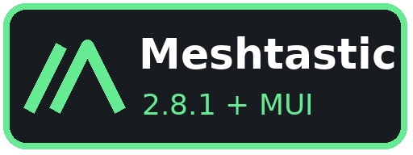

<p align="center">
  
</p>

<h1 align="center">Meshtastic on the Nintendo Wii</h1>

<p align="center">
  
  
  
  
  
  
  
  
  
  
  
</p>

The real [Meshtastic firmware](https://github.com/meshtastic/firmware) (pinned in
`build.sh`, currently **v2.8.1**) running natively on a Nintendo Wii, with
[MeshtasticUI](https://meshtastic.org/docs/configuration/device-uis/meshtasticui/)
on the TV and a USB LoRa radio. Routing, reliability, roles, rebroadcast modes,
the periodic modules and their intervals, airtime and congestion limits, PKI —
all of it is upstream code, not a re-implementation.

It is the firmware's portduino build shaped like its `native-wasm` target
(single-threaded `setup()` + `loop()`), with the radio reached through
`Ch341Hal` and a libogc USB backend.

## What you need

- A Wii with the [Homebrew Channel](https://wiibrew.org/wiki/Homebrew_Channel)
  and an SD card.
- A **MeshToad**-style USB radio: CH341 USB-to-SPI bridge (1a86:5512) with an
  SX1262 / E22 module, wired as in the firmware's
  `bin/config.d/lora-usb-meshtoad-e22.yaml`. Use the variant for your
  region's band.
- To build: Docker (the toolchain runs in containers) and Python 3.

## Install

```sh
./install.sh <wii-ip>
```

Open the Homebrew Channel first (its screen shows the Wii's IP). This builds
the firmware, then sends a one-shot installer that writes
`sd:/apps/meshtasticd/{boot.dol,meta.xml,icon.png}`. Press Home when it says
Done, and launch **Meshtastic** from the HBC menu from then on. Reinstalling
never touches your settings, node database or maps.

On first boot MUI asks for your **region** (no radio transmits until one is
set), or put it in `config.txt` (below).

## Using it

| Wiimote | MUI |
|---|---|
| point + **A** | tap |
| D-pad | move focus / scroll |
| **+** | Enter |
| **B** | back to the home screen |
| **Home** | save and quit to HBC |

**Phone and desktop apps** connect over Wi-Fi: add a network (TCP) device with
the Wii's IP (port 4403), or `meshtastic --host <wii-ip> --info`. When the CLI
*changes* settings, add `--wait-to-disconnect 5`. Otherwise it closes the
connection the moment it has written, and the Wii can lose the change (see
the notes). MUI loads settings when it starts and doesn't see changes made
from another client, so restart the app before editing the same settings in
MUI, or MUI writes back its old copy.

**MQTT** works over the Wii's Wi-Fi, plain or TLS (TLS 1.2/1.3 via wolfSSL),
set up the normal way (MUI, an app, or `meshtastic --set mqtt.enabled true
--set mqtt.address <broker>[:port] --set mqtt.tls_enabled true`), plus uplink
and/or downlink on the channels you want bridged. As on other boards, the
broker's certificate is not checked. Changing MQTT settings reboots the
firmware, which on the Wii means back to HBC: launch it again.

**Settings** can come from `sd:/apps/meshtasticd/config.txt`. See
`config.example.txt` for every key. It is applied once per change, as the same
admin messages the apps send.

**Offline maps**: MUI reads raster PNG tiles from
`sd:/apps/meshtasticd/maps/<style>/`. Each style is a folder holding either
`z/x/y.png` tiles or a single `<style>.pmtiles` file (PNG tiles inside;
vector tiles are not supported). Long-press the Map button to pick a style;
MUI remembers it. A region- or state-sized PMTiles bundle up to z15 is a
few hundred MB to a few GB, so check the card's free space.

State lives on the SD card in `sd:/apps/meshtasticd/` (`prefs/` is the
firmware's saved state). The node number comes from the console's device ID.

## Building and debugging

```sh
./build.sh                         # -> build/meshtasticd.dol
./send.sh <wii-ip>                 # run it once from HBC, without installing
./send.sh <wii-ip> region=EU_868   # ...and seed config.txt (key=value args)
WII_DEBUG_HOST=<pc-ip> ./build.sh  # stream the firmware log to <pc-ip>:4302
```

The first build fetches the firmware, MUI (device-ui) and libogc into
`third_party/` and builds a devkitPPC + PlatformIO image. Read the streamed
log with `tools/fwlog/fwlog.py` (its docstring has the `docker run` line).
`send.sh` goes through `tools/wiiload_relay.py`, which uses small TCP
segments, because the Wii's Wi-Fi drops plain wiiload uploads of this size.

| path | what |
|---|---|
| `build.sh`, `send.sh`, `install.sh` | build; run once over Wi-Fi; install to SD |
| `patches/` | changes to the upstream firmware (big-endian fixes, Wii display, TCP API) |
| `patches/device-ui/` | changes to MUI (Wii display driver, big-endian fixes) |
| `overlay/variants/native/wii/platformio.ini` | `[env:native-wii]` |
| `overlay/src/platform/portduino/wii/` | Wii glue: entry point, SD/identity, config.txt, Wi-Fi, CH341 backend (`libpinedio_ogc.c`), stubs |
| `overlay/lib/WiFi/` | framework-portduino's WiFi library on libogc sockets |
| `overlay-device-ui/` | MUI's Wii display/input driver (TV + Wiimote) |
| `platform-wii/` | PlatformIO platform (from meshtastic/platform-wasm, devkitPPC toolchain) |
| `libogc-usb/` | patched libogc `usb.c` |
| `docker/` | build image |
| `hbc/` | Homebrew Channel icon and `meta.xml` |
| `tools/` | SD installer, wiiload relay, log listener |
| `docs/` | `meshtastic-2.8.1-notes.md` (firmware behaviour notes and everything learned porting it), the logo |

## Licence

GPL-3.0 (the firmware's licence; see `LICENSE`). `libogc-usb/ogc_usb.c` keeps
libogc's zlib-style licence, `overlay/lib/WiFi` is LGPL-2.1 (from
framework-portduino), and `platform-wii/` keeps its own `LICENSE`. wolfSSL (GPL-3.0),
used for MQTT over TLS, is downloaded and built by `build.sh`, not vendored.
